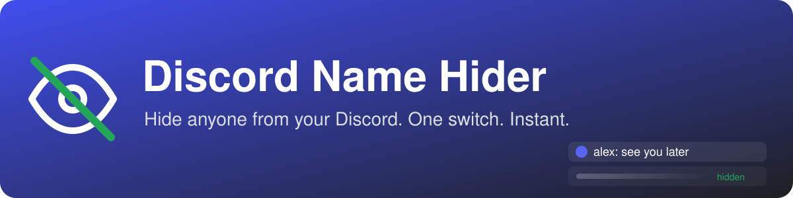
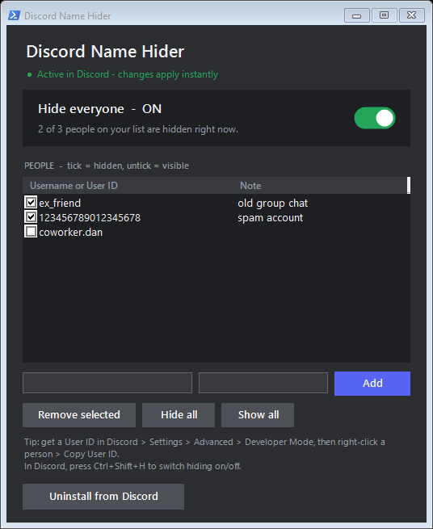

<div align="center">



<br><br>

[](https://github.com/rakawe86/discord-name-hider/releases/latest/download/DiscordNameHider.exe)

[](https://github.com/rakawe86/discord-name-hider/releases/latest)


**Hide anyone from your Discord: friends list, DMs, messages, everywhere.**<br>
One switch to hide, one switch to show. No restart, nothing to install.

</div>

---

<table>
<tr>
<td width="55%" valign="top">

### ✨ Features

- 🙈 **Hide people completely**: friends list, DMs, chat, member lists
- 🔘 **Hide everyone toggle**: one switch hides or shows your whole list
- ☑️ **Per-person checkboxes**: tick = hidden, untick = visible
- ⚡ **Instant**: changes apply live, no Discord restart
- ⌨️ **`Ctrl + Shift + H`** inside Discord toggles hiding
- 🔍 **Nothing slips through**: replies, @mentions, search, pins, reactions, voice, Active Now
- 💬 **Nothing is lost**: messages sent while hidden come back when you show them
- 🔒 **Private**: only *you* see the change. Nobody is blocked or notified
- 📦 **One .exe**: double-click and go

</td>
<td width="45%" valign="top">



</td>
</tr>
</table>

## 🚀 Quick start

| Step | |
|:---:|---|
| **1** | [**Download DiscordNameHider.exe**](https://github.com/rakawe86/discord-name-hider/releases/latest/download/DiscordNameHider.exe) |
| **2** | Double-click it → **Install into Discord** *(one time, Discord restarts once)* |
| **3** | Add people by **username** or **User ID** → ticked people disappear |

> [!TIP]
> **User IDs are the most reliable** (names can change).
> In Discord: *Settings → Advanced → Developer Mode*, then right-click a person → **Copy User ID**.

> [!NOTE]
> **"Windows protected your PC"?** The app isn't code-signed yet. Click **More info → Run anyway**.

## ❓ FAQ

<details>
<summary><b>Will the hidden person know?</b></summary>
<br>
No. Nothing is sent to Discord or to them. They are not blocked; it only changes what your Discord shows.
</details>

<details>
<summary><b>Do I need to reinstall after Discord updates?</b></summary>
<br>
No. It re-applies itself automatically after Discord updates.
</details>

<details>
<summary><b>How do I remove it?</b></summary>
<br>
Open the app and click <b>Uninstall from Discord</b>. Discord goes back to normal; your list is kept for next time.
</details>

<details>
<summary><b>How does it work?</b></summary>
<br>
The app installs a bundled build of <a href="https://github.com/Vendicated/Vencord">Vencord</a> with a small plugin
(<code>plugin/hideUsers</code>). Your list is saved in <code>%APPDATA%\DiscordNameHider\state.json</code> and the plugin
re-reads it every second, so changes are instant.
</details>

## 🛠️ Build from source

Requires Node.js 18+ and Git.

```powershell
powershell -ExecutionPolicy Bypass -File .\build-exe.ps1
```

## ⚠️ Disclaimer

Client modifications are against Discord's Terms of Service. Use at your own risk.
Not affiliated with Discord or Vencord.

## 📄 License

[GPL-3.0](LICENSE). Includes [Vencord](https://github.com/Vendicated/Vencord) (GPL-3.0).
